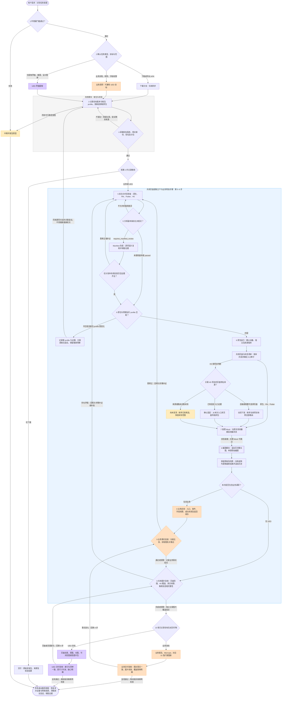

# Skill 整体编排说明

本文件用于执行前理解整体流程：一套十步主流程，下载、业务调研、UED 界面提取三个任务分支。第 2 步正式确定分支和范围，后续判断沿用该记录；同时要求业务和 UED 时，共用页面清单与图片，执行两个交付目标。

下图是现有工作流的导航图。取包、页面范围、截图和验收的具体规则以对应模块为准；调整主流程或分支规则时同步更新此图。

## 整体流程图

## 执行时如何读图

- **分支与复用**：灰色区域是三个分支共用的取包与校验；蓝色区域是业务/UED 的页面提取主干，其中橙色节点是业务附加步骤，纯 UED 跳过。混合技术栈分别处理各层，再汇入同一页面清单，不是整款 App 只能选一种技术栈。
- **H5 范围**：按每个纳入项目判断后端/配置值是否真正能选择页面。动态项目覆盖当前快照全部路由；固定项目从本次入口求使用闭包；未知项目继续补证，并保留受限结论。原生/RN/Flutter 的页面发现及状态范围也必须执行。
- **验收与交付**：业务事实、页面图片覆盖、最终呈现分别记录结论。未知总量、缺图、替代截图或长图失败不能记为完整提取；完成与受限结果都进入第 10 步检查交付物，受限交付明确保留缺口。
- **版本与设备**：第 3 步保存用户目标 versionCode，第四步自动承接；没有关联取包记录时显式传目标版本，显式值与记录冲突须失败。设备相关尝试预先记录实际取包 profile；换 profile 用父 id、新 profile 和证据理由建立关联尝试，相同 profile 不重复，三轮搜索预算不变。
- **副本一致性**：条目比对发现 Manifest 改变时返回 `requires_manifest_review`，须逐项核对实际语义差异；未经复核不能把副本截图认作原实现证据。无法补齐证据时继续可用的原包页面并记录缺口，不无限修改副本。
- **回路与停止**：回到第 5 步的箭头代表返回第 5–8 步中的相关节点，不要求全部重做。第 4 步回取包时保留尝试记录和已用搜索轮数；新增来源搜索仍最多三轮，关联 profile 尝试不是新增来源。反复纠错没有新证据时报告阻塞，不无限循环。第 10 步仅修复布局/坏链接时原地重测，事实/页面范围变化才回第 9 步。
- **校验记录**：长图每次复核均更新最新 `verification.json`，成功和失败历史均保留；验收使用与当前文件哈希一致的最新结果。`stitched` 或旧 `passed` 不能覆盖后续失败。
- **执行性质**：由 agent 根据证据编排这些步骤，脚本执行具体任务；所有退出路径都收尾。图中第 1 步之前只识别请求意图，商店、渠道等后续查询仍须通过环境门槛。

## 操作文档入口

任务分支见 [下载子工作流](download-workflow.md)、[业务调研工作流](research-workflow.md) 和 [UED 工作流](ued-workflow.md)。第 4 步必读 [校验与交付](verification.md)。共用操作见 [包体与代码恢复](package-analysis.md)、[运行与 Mock](runtime-and-mock.md)、[页面发现与图片提取](ui-extraction.md) 和 [截图与长图操作](screenshot-workflow.md)；业务报告验收见 [业务、UI 与报告](business-ui-report.md)。
